# 찍고끝 (CivicShot)

> 시민은 신고를 안 하는 게 아니라, 신고가 너무 비싼 것이다.
> 신고 비용을 0에 가깝게 내리면 참여는 따라온다.

망가진 가로등·벤치·보도블록을 **사진 한 장**으로 신고하고, 처리 상황을 **QR 하나**로 확인하는 모바일 웹(PWA)입니다. 가입도, 앱 설치도, 주소 입력도 필요 없습니다.

`Node 24` · `TypeScript` · `React 19` · `PWA` · `Playwright E2E` · `Cloud Run 데모`


> **지금 바로 써 보기**
>
> **[▶ 공개 데모 열기](https://civicshot-1072416881206.asia-northeast3.run.app)** · **[▶ 담당자(관리자) 화면 `/admin`](https://civicshot-1072416881206.asia-northeast3.run.app/admin)**
>
> - 휴대폰으로 열면 가장 자연스럽습니다. 사진이 없으면 첫 화면 아래 **샘플로 체험해 보기**(가로등·벤치·보도블록)를 누르세요.
> - 신고를 보낸 뒤 다른 탭에서 `/admin` 을 열어 상태를 바꿔 보면, 신고자 화면이 그대로 따라 바뀝니다.
> - **모의 기관이라 실제로는 접수되지 않아요.** 화면·주소·접수번호는 모두 체험용입니다.
> - 한동안 아무도 쓰지 않았다면 첫 접속이 몇 초 걸릴 수 있습니다.

---

## 이런 문제를 풉니다

| 시민의 마음 | 지금의 신고 | 찍고끝 |
|---|---|---|
| "신고하려니 귀찮다" | 앱 설치, 회원가입, 어느 기관 담당인지 구분, 주소 직접 입력 | 가입 없이 사진 한 장 → 확인 → "신고하기" |
| "했는데 처리됐는지 모르겠다" | 결과를 따로 찾아봐야 함 | 접수증 QR 로 진행 상황을 보고, 완료되면 알림 |
| "누가 하겠지" | 이미 신고됐는지 알 수 없어 그냥 지나침 | 같은 곳 신고는 한 건으로 묶고 "이미 N명이 신고했어요" 로 보여 줌 |

방향은 하나입니다. **신고 비용을 0에 가깝게.** 시설 종류·고장 유형·담당 부서는 사진과 위치로 자동으로 채우고, 시민은 틀린 칸만 고치면 됩니다. 같은 곳의 신고는 하나로 합치고, 처리 상황은 접수증의 QR 로 그 자리에서 봅니다.

## 3단계로 써 보기

<table>
  <tr>
    <th>① 찍기</th>
    <th>② 확인하기</th>
    <th>③-1 신고글 보기</th>
    <th>③-2 접수·QR</th>
  </tr>
  <tr>
    <td>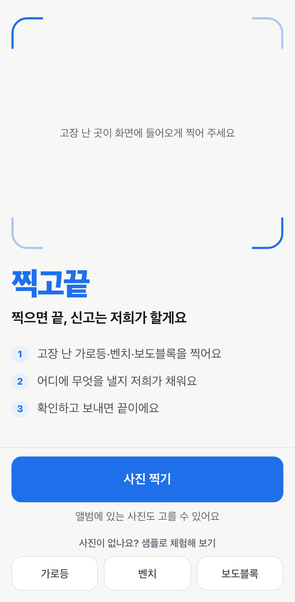</td>
    <td>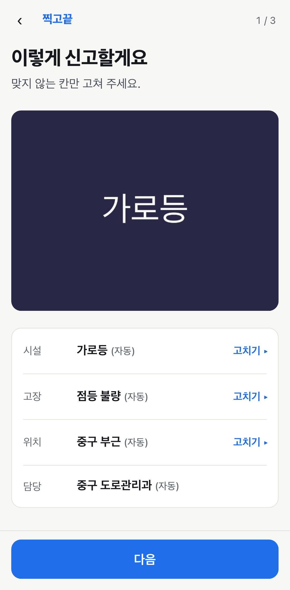</td>
    <td>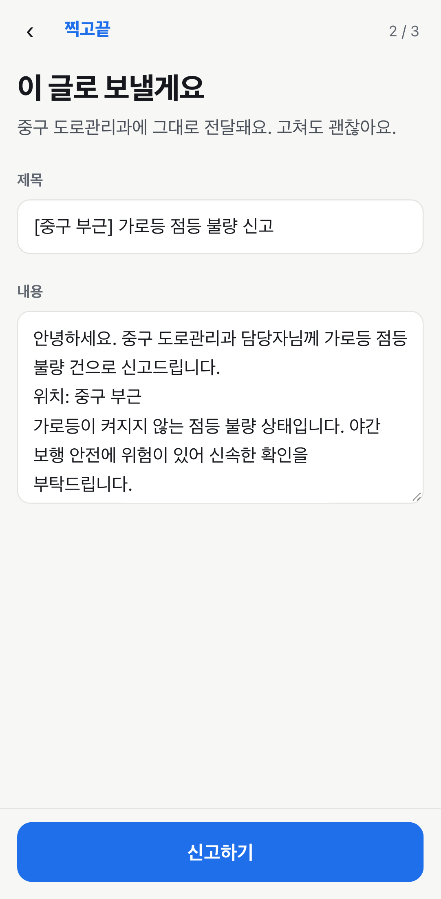</td>
    <td>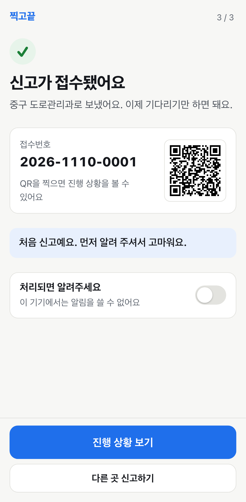</td>
  </tr>
  <tr>
    <td>사진을 찍거나 앨범에서 고릅니다. 사진이 없으면 <b>샘플로 체험해 보기</b>의 가로등·벤치·보도블록 중 하나를 누르세요.</td>
    <td>시설·고장·위치·담당 칸이 <b>(자동)</b> 표시와 함께 채워집니다. 맞지 않는 칸만 <b>고치기</b>를 누르면 됩니다.</td>
    <td>담당 부서에 그대로 보낼 제목과 내용이 만들어져 있습니다. 고쳐도 되고, 그대로 <b>신고하기</b>를 눌러도 됩니다.</td>
    <td>접수번호와 QR 이 나옵니다. QR 을 찍거나 <b>진행 상황 보기</b>를 누르면 처리 단계를 볼 수 있습니다.</td>
  </tr>
</table>

처리 단계는 **접수 → 배정 → 처리중 → 완료** 순서입니다. 담당자가 완료로 바꾸면 완료 사진과 함께 신고자 화면이 바뀝니다.

<table>
  <tr>
    <th>배정됨</th>
    <th>처리 완료</th>
  </tr>
  <tr>
    <td>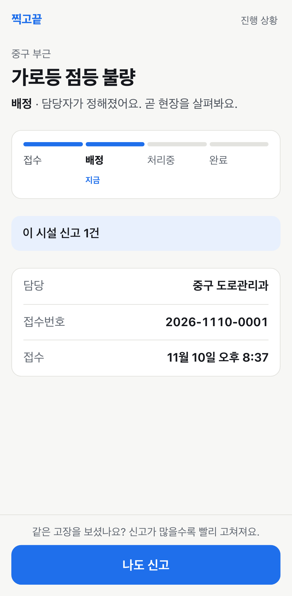</td>
    <td>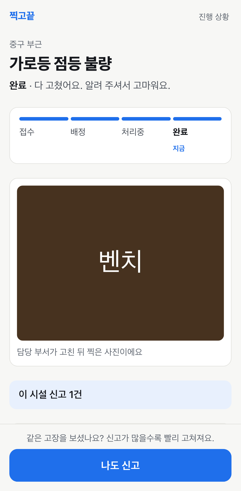</td>
  </tr>
</table>

## 기능 한눈에 보기

### 샘플로 바로 체험
사진이 없어도 첫 화면의 샘플 버튼 하나로 처음부터 접수증까지 끝까지 가 볼 수 있습니다. 샘플 사진에는 촬영 위치가 들어 있어 위치·담당 부서까지 자동으로 채워집니다.


### 담당자가 바꾸면 신고자 화면도 바뀜
담당자 화면(`/admin`)에서 상태를 배정 → 처리중 → 완료로 바꾸면, 신고자의 진행 상황 화면이 몇 초 안에 따라 바뀝니다. 담당자 화면은 체험용이며 실제 지자체와 연결돼 있지 않다는 띠가 위에 붙어 있습니다.

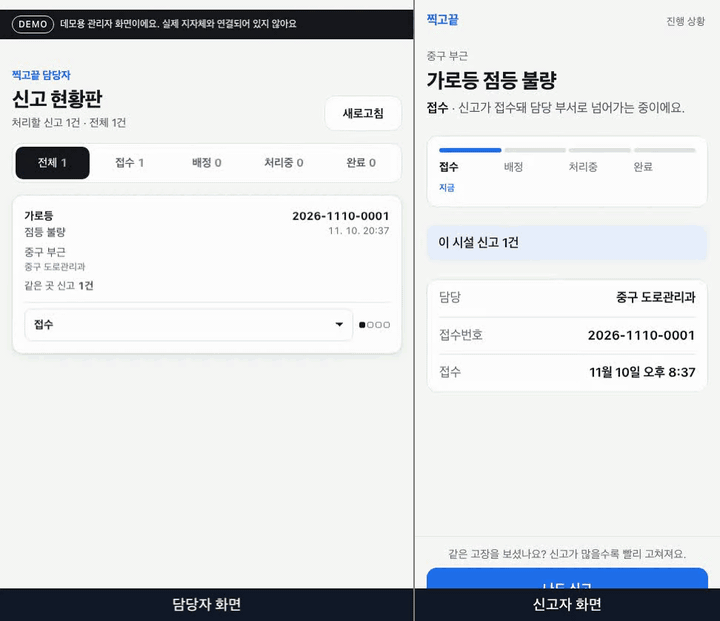

### 같은 곳은 한 건으로
같은 시설을 가까운 곳(기본 20 m 안)에서 다른 사람이 이미 신고했다면 새 건을 만들지 않고 하나로 묶습니다. 접수증에 "이미 2명이 신고했어요. 하나로 묶어 전달해요." 처럼 보여 줘서 "누가 하겠지" 대신 "나도 보탰다"가 됩니다.

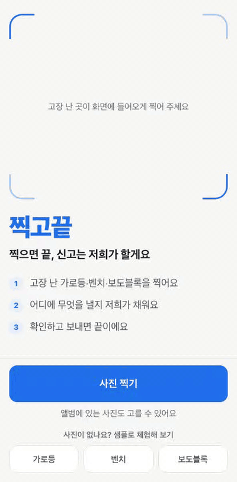

### 연결이 끊겨도 신고
지하나 엘리베이터처럼 인터넷이 끊긴 곳에서도 신고를 누를 수 있습니다. 신고는 휴대폰에 담아 두고, 연결되면 자동으로 보냅니다. 화면 위에 "인터넷이 끊겼어요. 연결되면 이어서 보낼게요." 띠가 뜹니다.

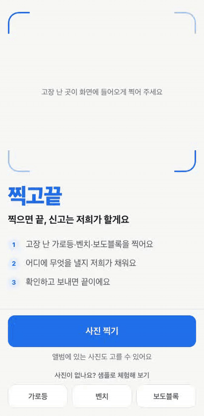

### QR 로 상태 보기
접수증의 QR 은 그 신고의 진행 상황 페이지를 가리킵니다. 다른 기기로 찍어도 같은 화면이 열리고, 가입 없이 QR 만으로 볼 수 있습니다.

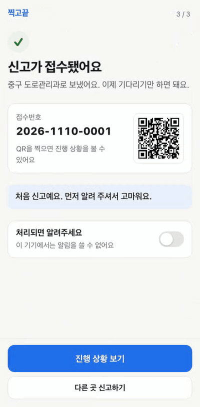

### GPS 가 없으면 지도로 위치 맞추기
사진에 위치가 없거나 틀렸다면 확인 화면의 위치 **고치기**를 눌러 지도에서 핀을 맞춥니다. 위도·경도로 직접 넣을 수도 있습니다.

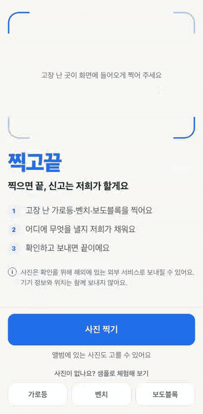

### 응급은 112·119 로 안내
사람이 다쳤거나 위험해 보이는 사진이면 신고 글을 만들지 않고 "지금 바로 전화해 주세요" 화면으로 119(화재·구급)와 112(경찰)를 안내합니다. 찍고끝은 응급 신고를 대신하지 않습니다.

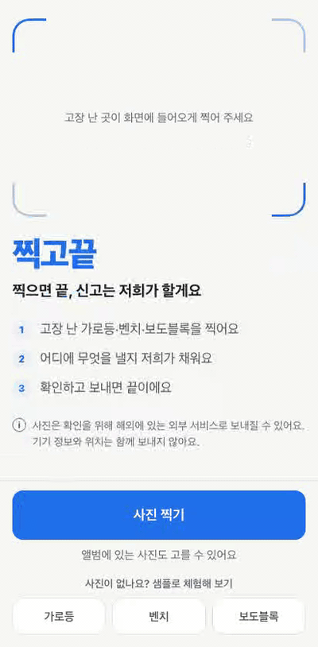

### 확인 실패·요청이 많을 때의 안내
사진 확인이 잠시 안 되면 "사진을 확인하지 못했어요. 다시 해 볼래요?" 와 **다시 해 볼게요** 버튼이, 짧은 시간에 요청이 몰리면 "지금은 확인 요청이 많아요. 약 N초 뒤에 다시 해 주세요." 가 나옵니다. 어느 경우든 샘플 사진으로는 계속 체험할 수 있습니다.

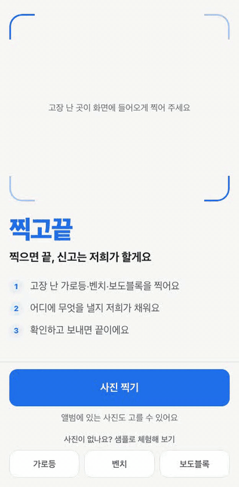

<table>
  <tr>
    <th>확인 실패</th>
    <th>요청이 많을 때</th>
    <th>외부 전송 고지</th>
  </tr>
  <tr>
    <td>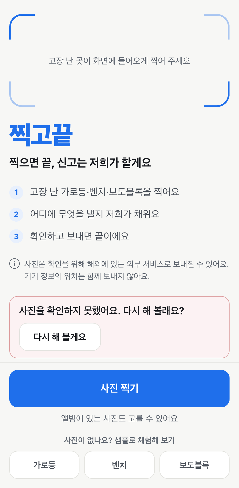</td>
    <td>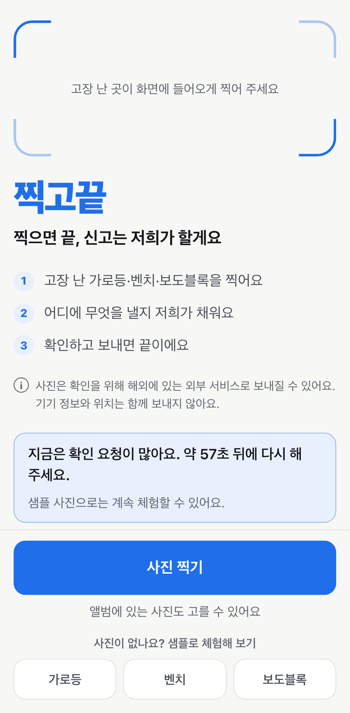</td>
    <td>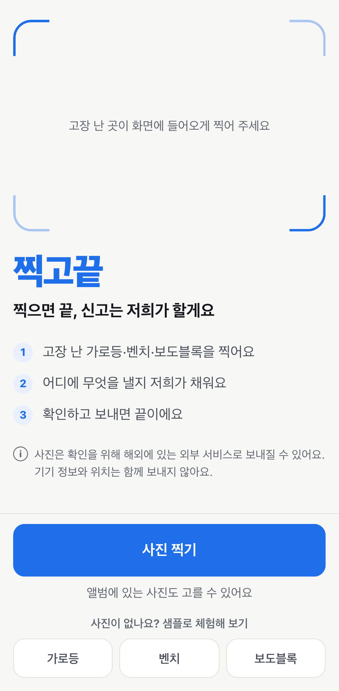</td>
  </tr>
</table>

### 기능 요약표

| 기능 | 한 줄 설명 |
|---|---|
| 샘플 체험 | 사진이 없어도 가로등·벤치·보도블록 샘플로 접수증까지 체험 |
| 자동 채우기 | 시설·고장·위치·담당 부서를 "(자동)" 표시와 함께 채우고, 틀린 칸만 고침 |
| 신고글 미리보기 | 담당 부서에 보낼 제목·내용을 만들어 주고, 고쳐서 보낼 수 있음 |
| 접수증·QR | 접수번호와 진행 상황 QR, 가입 없이 상태 확인 |
| 상태 반영·알림 | 담당자가 바꾼 상태가 신고자 화면에 반영되고, 완료 때 알림 |
| 중복 묶기 | 같은 곳(20 m 안) 같은 시설 신고는 한 건으로, "이미 N명이 신고했어요" |
| 오프라인 신고 | 인터넷이 끊겨도 휴대폰에 담아 두고 연결되면 자동 전송 |
| 지도 위치 보정 | 위치가 없거나 틀리면 지도에서 핀으로 맞춤 |
| 응급 안내 | 위험해 보이는 사진은 112·119 로 바로 안내 |
| 친절한 오류 안내 | 확인 실패·요청 많음을 쉬운 말로 알리고 다시 해 보게 함 |
| 담당자 화면(모의) | 신고 현황판에서 상태별로 보고 바꾸는 체험용 화면 |

모든 화면을 한 번에 보려면 [화면 갤러리](docs/gallery.md)를 여세요.

## 자주 묻는 질문

**Q. 정말 기관에 접수되나요?**
아니요. 공개 데모는 **모의 기관**에만 보냅니다. 실제 기관으로 보내는 통로(국제 공개 표준 Open311, 지자체 이메일)는 만들어 두었지만, 국내 기관의 외부 접수 창구를 공식 문서로 확인하지 못해 꺼 두었습니다. 자세한 내용은 [실제 기관 연동은 어디까지인가](#실제-기관-연동은-어디까지인가)에 있습니다.

**Q. 사진은 어떻게 쓰이고, 위치는 어떻게 되나요?**
사진은 휴대폰 안에서 한 번 다시 저장해 올리므로 기기 정보 같은 숨은 정보가 빠집니다. 위치는 신고 지점 하나만 저장합니다. 사진은 7일, 신고는 30일 뒤 자동으로 지워집니다. 실제 사진 확인 기능을 켠 서버에서는 사진이 해외에 있는 외부 서비스로 보내질 수 있고, 첫 화면에 그 사실을 한 줄로 알립니다. 이때도 기기 정보와 위치는 함께 보내지 않습니다.

**Q. 가입이 필요한가요?**
아니요. 이름·전화번호·이메일을 받지 않습니다. 내 신고는 휴대폰에 남는 임의의 표식으로만 구분합니다.

**Q. 샘플 사진은 왜 있나요?**
고장 난 가로등 앞에 서 있지 않아도 끝까지 체험해 볼 수 있게 하려고요. 샘플은 사진 확인 과정을 거치지 않고 바로 채워지므로 요청이 많을 때도 언제든 쓸 수 있습니다.

**Q. "지금은 확인 요청이 많아요"는 왜 나오나요?**
공개 데모는 누구나 쓸 수 있어서, 한 사람이 1분에 5번·하루 20번, 서버 전체가 하루 300번까지만 직접 고른 사진을 확인합니다. 넘으면 몇 초 뒤(또는 내일) 다시 해 달라고 안내합니다. 샘플 사진은 이 한도와 상관없습니다.

**Q. 응급 상황은요?**
찍고끝은 응급 신고를 받지 않습니다. 사람이 다쳤거나 불·연기가 보이면 119, 사고·범죄·위협이면 112 로 바로 전화하도록 안내 화면을 띄웁니다.

**Q. 어떤 시설을 신고할 수 있나요?**
지금은 **가로등·벤치·보도블록** 세 가지입니다. 그 밖의 사진은 "아직 지원하지 않는 시설"로 안내합니다. 담당 부서 자동 지정은 서울 25개 구 안에서만 됩니다.

**Q. 같은 곳을 또 신고하면?**
가까운 곳(기본 20 m 안)의 같은 시설 신고는 한 건으로 묶이고 신고한 사람 수만 늘어납니다. 담당자는 같은 건을 여러 번 받지 않고, 시민은 이미 접수된 것을 알 수 있습니다.

**Q. 오프라인에서도 되나요?**
네. 인터넷이 끊긴 상태에서 신고하기를 누르면 휴대폰에 담아 두었다가, 연결되면 자동으로 보냅니다.

**Q. 설치해야 하나요?**
아니요. 브라우저로 열면 바로 됩니다. 자주 쓰려면 브라우저 메뉴의 **홈 화면에 추가**로 앱처럼 둘 수 있습니다(PWA).

---

> 여기부터는 개발자용 설명입니다.

## 어떻게 동작하나요

시민이 사진을 고르면, 서버가 사진을 보고 무슨 시설이 어떻게 고장 났는지 판단하고, 사진의 위치로 어느 구청 어느 부서 담당인지 정합니다. 그 결과로 신고글을 만들어 시민에게 보여 주고, 시민이 보내면 같은 곳의 신고가 있는지 확인한 뒤 기관(데모는 모의 기관)에 제출합니다. 담당자가 상태를 바꾸면 기관이 웹훅으로 알려 주고, 신고자 화면과 알림에 반영됩니다.

| 단계 | 시민이 보는 것 | 안에서 하는 일 |
|---|---|---|
| 1. 사진 | 찍기·고르기·샘플 | 브라우저에서 재인코딩(EXIF 제거·축소), 촬영 위치는 exifr 로 읽어 따로 보냄 (`POST /api/photos`) |
| 2. 분류 | 시설·고장 "(자동)" | 샘플은 fixture 로 바로, 그 외는 비전 모델(Qwen VL, OpenAI 호환, 선택). 키가 없거나 실패하면 fixture 로 강등 (`POST /api/classify`) |
| 3. 관할 | 위치·담당 "(자동)" | 서울 25구 시군구 경계(오프라인 GeoJSON) + point-in-polygon 으로 구청 부서 지정. 주소 문구는 오프라인 라벨, Nominatim 선택 (`POST /api/locate`) |
| 4. 양식 | 신고글 미리보기 | 서식 템플릿(기본) 또는 LLM(선택). 실패·한도 초과면 템플릿 (`POST /api/form`) |
| 5. 제출 | 접수번호·QR | 중복 병합 확인 후 `SubmissionAdapter` 로 제출, 최대 3회 재시도 (`POST /api/reports`) |
| 6. 상태 | 진행 상황·알림 | 모의 기관 웹훅 → 이슈 상태 갱신 → 완료 때 Web Push, 상태 화면은 5초마다 갱신 |

- **중복 병합**: H3 셀로 근처 후보를 빠르게 좁히고 haversine 거리로 `MERGE_RADIUS_M`(기본 20 m) 안의 같은 시설이면 기존 이슈에 신고를 붙입니다. PostGIS 같은 DB 확장 없이 SQLite 로 충분합니다.
- **관할·부서**: 저장소에는 서울 25구 경계 추출본만 들어 있어 외부 호출 없이 판정합니다. 다른 지역은 부서를 자동으로 정하지 못합니다.
- **샘플 우선·요청 제한**: 첫 화면 샘플은 모델을 부르지 않고 fixture 로 처리합니다(비용 0, 합성 샘플을 실제 모델이 범위 밖으로 볼 수 있음). 직접 고른 사진만 외부 모델을 부르고, 그 **호출 직전에만** 요청 제한(IP 별 분 5·일 20, 전체 일 300)을 차감합니다. 분류가 한도를 넘으면 429 + `Retry-After` 로 화면이 "약 N초 뒤" 를 안내하고, 양식은 템플릿으로 대체합니다.

## 아키텍처

구성도:

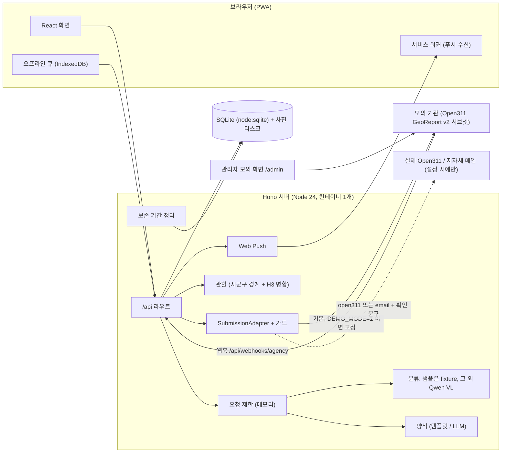

신고 시퀀스:

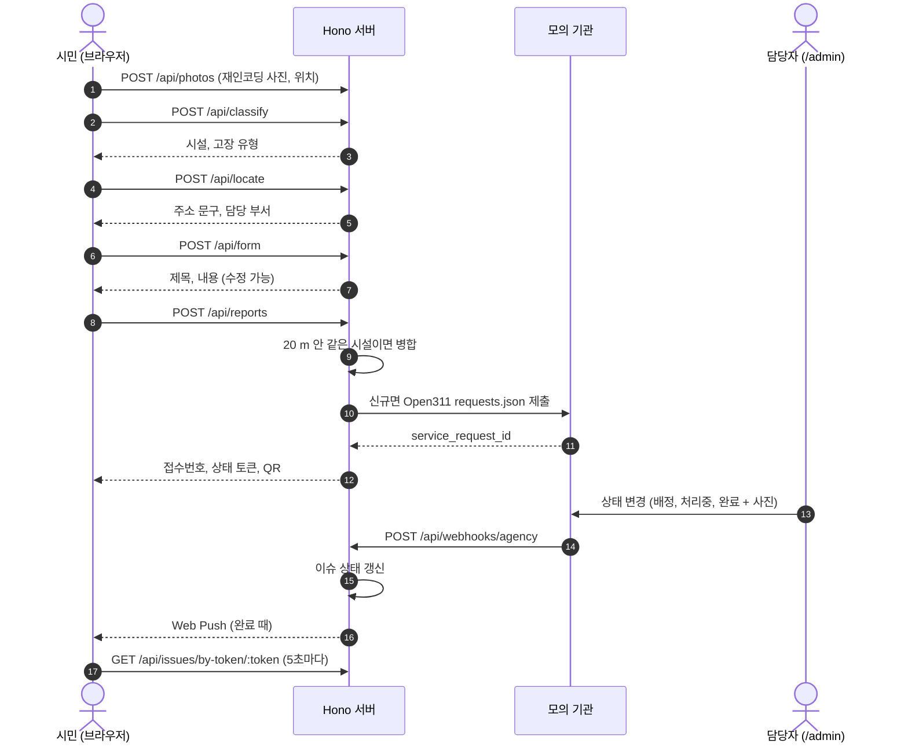

모듈 지도·데이터 모델·API 표·가드·확장점은 [docs/system-overview.md](docs/system-overview.md) 에 있습니다.

## 사용한 오픈소스
직접 처음부터 만들지 않고, 검증된 라이브러리와 공개 표준을 가져다 썼습니다. 직접 짠 것은 이들을 잇는 흐름과 화면, 그리고 안전장치(가드)입니다.

| 기능 | 라이브러리/서비스 | 쓰는 이유 |
|---|---|---|
| 서버 | [Hono](https://hono.dev) + `@hono/node-server` | Web 표준 Request 기반, 작고 TypeScript 친화. Node 24 가 TS 를 그대로 실행해 빌드 단계가 없음 |
| 화면 | React 19 + React Router | 화면 단위 구성 |
| 빌드 | Vite 8 | 정적 빌드를 서버가 그대로 서빙 → 컨테이너 1개 |
| PWA | vite-plugin-pwa, `idb` | 서비스 워커·오프라인 큐 |
| DB | `node:sqlite` (Node 내장) | 네이티브 빌드 없음, 데모는 인스턴스 로컬 데이터로 충분 |
| 사진 메타데이터 | exifr | 촬영 위치·시각 읽기 |
| 사진 압축 | compressorjs | 브라우저에서 재인코딩 → EXIF 제거와 용량 축소를 한 번에 |
| 사진 분류 | Qwen VL (OpenAI 호환 엔드포인트, 선택) | 고장 유형까지 판별. 키가 없으면 fixture 분류 |
| 요청 제한 | [rate-limiter-flexible](https://github.com/animir/node-rate-limiter-flexible) | 외부 모델 호출 직전에만 한도를 소비하고 초과 시 폴백하는 흐름에 맞춤 |
| 양식 생성 | 서식 템플릿 (기본) + Qwen LLM (선택) | 키 없이 항상 동작, 결정적 테스트 |
| 관할 경계 | southkorea-maps 시군구 GeoJSON + mapshaper | 시군구(구청) 단위 부서 배정 |
| point-in-polygon | @turf/boolean-point-in-polygon | 표준·작음 |
| 중복 병합 | h3-js + haversine | DB 확장(PostGIS) 없이 근처 후보 축소 |
| 역지오코딩 (선택) | Nominatim | 키 없이 사용 가능. 기본은 오프라인 경계 라벨 |
| QR | qrcode | 서버에서 SVG 생성, 외부 호출 없음 |
| 알림 | web-push (Web Push 표준) | 가입 없음과 맞고 비용 0 |
| 지도 (위치 보정) | Leaflet + OpenStreetMap 타일 | 가장 작고 터치 조작이 단순 |
| 모의 기관 | Open311 GeoReport v2 표준의 서브셋 | 공개 표준을 그대로 구현 → 실제 Open311 서버와 같은 어댑터로 연결 |
| 테스트 | Playwright, Vitest, smtp-server | E2E·단위·이메일 수신 sink |

## 실행 방법

### (a) 가장 빠른 길 — 키 없이

요구사항: Node 24.12 이상. (선택) Docker, GIF 를 다시 만들려면 ffmpeg.

```bash
npm install && npx playwright install chromium
npm run dev          # API 8870 + 화면 http://localhost:8871
```

1. 브라우저에서 http://localhost:8871 을 열고 첫 화면의 **샘플로 체험해 보기**(가로등·벤치·보도블록)를 누릅니다.
2. 담당자 모의 화면 http://localhost:8871/admin 에서 상태를 바꾸면 신고자 상태 화면에 반영됩니다.
3. 키가 없어도 모든 흐름이 돕니다: 분류는 fixture, 양식은 템플릿, 주소는 오프라인 경계, 제출은 모의 기관.

### (b) 실제 모델로 써 보기

`.env` 에 아래 값을 넣습니다(커밋하지 않습니다).

```bash
LLM_BASE_URL=https://dashscope-intl.aliyuncs.com/compatible-mode/v1
LLM_API_KEY=<키>
LLM_MODEL=qwen3.7-flash
VISION_MODEL=<이미지 입력을 받는 모델 이름>
VISION_BACKEND=qwen
LLM_BACKEND=qwen
```

서버는 `.env` 를 **자동으로 읽지 않습니다.** 환경변수로 올려서 실행합니다.

```bash
node --env-file=.env src/server/main.ts      # API 8870
npm run dev:client                            # 다른 터미널에서 화면 8871
```

확인은 `curl -s http://localhost:8870/api/status` 의 `backends` 가 `qwen` 으로 나오는지 봅니다. `.env` 에 `VISION_BACKEND`·`LLM_BACKEND` 를 `fixture`/`template` 로 적어 두면 키가 있어도 그 값이 우선합니다. 실제 모델은 직접 고른 사진에서만 불리고, 샘플 버튼은 계속 모델 없이 처리됩니다.

**연결 진단**: 키와 모델이 실제로 동작하는지 한 번 확인합니다.

```bash
node --env-file=.env scripts/check-llm.ts [사진경로]
```

`.env` 의 `LLM_BASE_URL`·`LLM_MODEL`·`VISION_MODEL`·`LLM_API_KEY` 로 글 모델 1회와 이미지 모델(사진을 주지 않으면 샘플 3장, 주면 그 사진)을 운영과 같은 프롬프트로 부르고, 상태 코드·소요 시간·응답이 분류 형식으로 읽혔는지를 보여 줍니다. 키와 이미지 데이터는 출력하지 않습니다. 마지막의 결론 문구가 무엇을 고칠지(키·주소·모델 이름, 이미지 미지원, 느린 응답이면 늘릴 타임아웃 값)를 알려 줍니다.

### (c) Docker — 서버와 빌드된 화면을 컨테이너 하나로

```bash
docker build -t civicshot:local .
docker run --rm -p 8880:8870 civicshot:local   # http://localhost:8880
```

이미지는 데모 모드(`DEMO_MODE=1`)가 기본입니다.

### (d) 데모 모드 (`DEMO_MODE=1`)

어떤 설정이 들어와도 제출 어댑터를 **모의 기관으로 고정**합니다. 관리자 화면에 인증이 없고 누구나 신고를 만들 수 있는 공개 데모에서 실제 기관으로 민원이 나가면 안 되므로, 공개 배포에서는 반드시 켭니다(Dockerfile 과 Cloud Run 설정의 기본값).

```bash
DEMO_MODE=1 npm run dev
```

## 환경변수
모두 선택입니다. 값이 없으면 기본값으로 키 없이 동작합니다(fixture 분류·템플릿 양식·오프라인 주소·모의 기관). 키 값은 `.env` 에만 두고 커밋하지 않습니다. 서버 변수의 기본값은 `src/server/config.ts` 와 같습니다.

| 이름 | 기본값 | 설명 |
|---|---|---|
| `PORT` | `8870` | API 서버 포트 |
| `SELF_BASE_URL` | `http://localhost:<PORT>` | 서버가 자기 자신(모의 기관 등)을 부를 주소 |
| `PUBLIC_BASE_URL` | `http://localhost:8871` | QR·상태 링크에 들어가는 공개 주소 |
| `DATA_DIR` | `./data/runtime` | SQLite·사진 저장 위치 |
| `DEMO_MODE` | (꺼짐) | `1` 이면 제출을 모의 기관으로 고정. 공개 배포 필수 |
| `ALLOW_TEST_ROUTES` | (꺼짐) | `1` 이면 E2E 용 `/api/_test/*` 등록 |
| `VISION_BACKEND` | `fixture` | `fixture` 또는 `qwen` |
| `VISION_MODEL` | (빈 값) | 비전 모델 이름 (qwen 일 때). 이미지 입력을 받는 모델이어야 하고, 추론형 모델은 응답이 느릴 수 있어 타임아웃을 늘려야 함. `qwen3.8-max` 는 이미지 입력 지원을 확인함(2026-11-10) |
| `VISION_TIMEOUT_MS` | `15000` | 분류 요청 제한 시간 (Cloud Run 배포 키트는 `30000`) |
| `LLM_BACKEND` | `template` | 양식 생성: `template` 또는 `qwen` |
| `LLM_MODEL` | `qwen3.7-flash` | 양식 생성 모델 |
| `LLM_BASE_URL` | `https://dashscope-intl.aliyuncs.com/compatible-mode/v1` | OpenAI 호환 엔드포인트 (분류·양식 공용). 분류에는 이미지 입력을 받는 모델이 필요 |
| `LLM_API_KEY` | (빈 값) | 키. 없으면 fixture·템플릿 |
| `LLM_TIMEOUT_MS` | `10000` | 양식 생성 제한 시간 (Cloud Run 배포 키트는 `20000`) |
| `RATE_LIMIT_PER_MINUTE` | `5` | 같은 IP 가 1분에 부를 수 있는 외부 모델 호출 수. `0` = 끔 |
| `RATE_LIMIT_PER_DAY` | `20` | 같은 IP 의 하루 외부 모델 호출 수. `0` = 끔 |
| `RATE_LIMIT_DAILY_TOTAL` | `300` | 서버 전체의 하루 외부 모델 호출 수. `0` = 끔 |
| `TRUSTED_PROXY_HOPS` | `0` | 앞단 프록시 단 수. 요청 제한이 보는 클라이언트 IP 를 `X-Forwarded-For` 뒤에서 이만큼 건너 읽음. Cloud Run 은 `1` |
| `GEOCODER` | `offline` | `offline`(시군구 경계 라벨) 또는 `nominatim` |
| `NOMINATIM_URL` | `https://nominatim.openstreetmap.org` | Nominatim 주소 |
| `MERGE_RADIUS_M` | `20` | 같은 시설 신고 병합 반경(m) |
| `SUBMISSION_ADAPTER` | `mock` | `mock`·`open311`·`email` |
| `SUBMISSION_LIVE_CONFIRM` | (빈 값) | 실제 발송 확인 문구. 정확히 일치해야 open311·email 이 켜짐 |
| `OPEN311_ENDPOINT` | (빈 값) | 실제 Open311 GeoReport v2 주소 |
| `OPEN311_API_KEY` | (빈 값) | Open311 키 |
| `OPEN311_JURISDICTION_ID` | (빈 값) | Open311 관할 ID |
| `SMTP_URL` | (빈 값) | 이메일 어댑터 SMTP 주소 |
| `SUBMISSION_EMAIL_TO` | (빈 값) | 이메일 수신 주소 |
| `SUBMISSION_EMAIL_FROM` | (빈 값) | 이메일 발신 주소 |
| `VAPID_PUBLIC_KEY` | (빈 값) | Web Push 공개 키. 없으면 알림 끔 |
| `VAPID_PRIVATE_KEY` | (빈 값) | Web Push 비밀 키 |
| `VAPID_SUBJECT` | `mailto:demo@example.com` | Web Push 연락처 |
| `PUSH_SINK_URL` | (빈 값) | 테스트용: 푸시를 이 주소로 대신 보냄 |
| `PHOTO_TTL_DAYS` | `7` | 사진 보존 기간(일) |
| `REPORT_TTL_DAYS` | `30` | 신고 보존 기간(일) |
| `SWEEP_MINUTES` | `10` | 보존 기간 정리 주기(분) |
| `CLIENT_DIST_DIR` | `dist/client` | 서버가 서빙할 빌드된 화면 |
| `VISION_FIXTURE_DIR` | `tests/e2e/fixtures/vision` | fixture 분류 데이터 위치 |
| `VITE_API_MODE` | `real` | 화면 개발용: `mock` 이면 백엔드 없이 목업 API |
| `VITE_VAPID_PUBLIC_KEY` | (빈 값) | 화면에서 푸시 구독에 쓰는 공개 키 |

## 테스트

```bash
npm run typecheck
npm test        # 단위 (Vitest)
npm run e2e     # E2E (Playwright, 서버를 스스로 띄움) + PWA 빌드본 검사
```

직접 실행한 결과 (2026-11-10, 로컬):

| 구분 | 결과 | 소요 |
|---|---|---|
| 단위 (`npm test`, Vitest) | 11 파일 · **105건 통과** | 0.2초 |
| E2E (`npx playwright test`, Pixel 7 화면) | **119건 통과** | 1.2분 |
| PWA (`playwright.pwa.config.ts`, 빌드본) | **2건 통과** | 2.8초 |
| 합계 (`npm run e2e`, 빌드 포함) | 121건 통과 | 77초 |

- **격리**: 기능별 spec 은 각자 격리된 API·Vite 서버 쌍과 임시 데이터 폴더를 띄워 서로 영향을 주지 않습니다. 화면 프로토타입 spec(`ui-citizen`, `ui-admin`)은 목업 API 로 따로 돌고, PWA 는 별도 설정으로 빌드본을 검사합니다.
- **전체 흐름 (`tests/e2e/full-flow.spec.ts`)**: 실제 화면으로 사진 업로드 → 자동 분류 → 관할 → 양식 → 제출 → 모의 기관 접수 → 접수증 QR 을 거친 뒤, 관리자 화면에서 배정·처리중·완료(사진)로 바꾸면 신고자 화면이 그대로 따라오고 푸시가 완료 때 정확히 1건 나가는지 확인합니다. QR 이 가리키는 상태 페이지, 8 m 떨어진 신고 병합과 25 m 이상 분리, 5 MB 초과 거부, 응급 사진의 112·119 안내, 시민 화면에 "모델·분류기" 같은 기술 용어가 없는지도 함께 봅니다.
- **실제 모델은 테스트에서 부르지 않습니다.** 가짜 모델 서버로 Qwen 경로(요청 형식·타임아웃·폴백·요청 제한·로그에 키 없음)를 검증합니다. 실제 호출 확인은 `scripts/check-llm.ts` 로 합니다.
- **배포본 스모크**: `E2E_BASE_URL=<주소> npx playwright test tests/e2e/full-flow.spec.ts` 처럼 주소를 주면 로컬 서버를 띄우지 않고 그 주소에 붙어 검사합니다.
- 콜드 스타트 개선: spec 마다 새로 띄운 개발 서버의 첫 화면 요청이 의존성 최적화를 한꺼번에 치러 첫 테스트가 가끔 시간 초과로 흔들렸습니다. `vite.config.ts` 의 `optimizeDeps.include`·`server.warmup` 으로 콜드 첫 테스트를 44.9초 → 3.5초로 줄였습니다.

## 배포
`deploy/gcp/` 에 GCP Cloud Run 데모 키트가 있습니다.

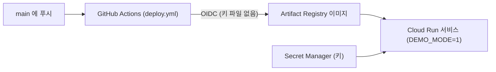

1. `deploy/gcp/setup.sh` — API 켜기, Artifact Registry, 런타임·배포 서비스 계정, GitHub OIDC(WIF), 비밀 이름 준비. 여러 번 돌려도 되고 `--dry-run`·`--verify` 를 지원합니다.
2. `deploy/gcp/apply-env.sh` — `deploy/gcp/service.yaml` 을 렌더해 서비스를 만들고 `/health` 를 확인합니다. 비밀 값은 사용자가 줄 때만 넣습니다.
3. 이후 `main` 에 푸시하면 GitHub Actions(`.github/workflows/deploy.yml`)가 이미지를 빌드해 교체합니다.

- **비용 최소**: 요청이 없으면 인스턴스 0(`minScale 0`), 최대 1(`maxScale 1`), 요청 처리 중에만 CPU, 512 MiB.
- **키는 비밀 관리자에만**: 서비스 설정 파일에는 값이 없습니다. 키가 있는데 `LLM_BASE_URL`·`VISION_MODEL` 이 환경에 없으면 제공사마다 주소·모델 이름이 달라 서비스가 깨질 수 있어서, 스크립트가 안내 문구를 내고 중단합니다. 모델·타임아웃·요청 제한은 같은 줄에 환경변수로 덧붙여 바꿉니다(기본: 분 5·일 20·전체 일 300, 분류 30초·양식 20초).

```bash
set -a; . ./.env; set +a; \
CLOUDSDK_CORE_ACCOUNT=<gcloud 계정> GCP_PROJECT_ID=<프로젝트> GCP_REGION=asia-northeast3 \
IMAGE=asia-northeast3-docker.pkg.dev/<프로젝트>/civicshot/civicshot:<태그> \
bash deploy/gcp/apply-env.sh
```

- 상태 확인은 `/health` (Cloud Run 이 `/healthz` 를 앱에 넘기지 않음).
- **읽기 전용 루트**: 컨테이너는 `DATA_DIR=/tmp/civicshot` 에만 써서 루트 파일시스템이 읽기 전용이어도 돌고, `node` 사용자로 실행합니다. 데이터는 인스턴스가 내려가면 사라지는 데모용입니다.
- 데모는 `DEMO_MODE=1` + 모의 기관 고정입니다.

## 개인정보와 보안
- **가입 없음**: 가입·로그인이 없습니다. 신고자는 기기에 남는 난수 토큰으로만 구분합니다.
- **EXIF 제거**: 사진은 브라우저에서 재인코딩해 올리므로 EXIF(기기 정보 등)가 서버에 남지 않습니다. 위치는 신고 좌표만 저장합니다.
- **보존 기간**: 사진 7일, 신고 30일 (`PHOTO_TTL_DAYS`, `REPORT_TTL_DAYS`). 서버가 `SWEEP_MINUTES` 마다 지웁니다.
- **로그**: 좌표·IP·키를 출력하지 않도록 설계했고, 키·IP 가 로그에 없는지를 E2E 로 확인합니다.
- **외부 전송 고지**: 키를 설정하면 사진이 확인을 위해 해외에 있는 외부 서비스로 보내질 수 있습니다. 보내는 것은 EXIF 위치가 제거된 재인코딩 이미지뿐이고, 좌표·기기 정보는 보내지 않습니다. 첫 화면에 같은 고지가 있습니다.
- **요청 제한**: 외부 모델 호출은 IP 별 분 5·일 20, 서버 전체 일 300 으로 제한합니다(기본값, 환경변수로 조정). 한도는 서버 메모리에 있습니다. 제공자 콘솔에서 지출 한도도 따로 설정하길 권합니다.
- **DEMO_MODE 가드**: `DEMO_MODE=1` 이면 어떤 설정이든 제출이 모의 기관으로 고정되고, 실제 발송은 `SUBMISSION_LIVE_CONFIRM` 확인 문구가 정확히 맞을 때만 켜집니다. 거부된 설정은 `/api/status` 의 `refused` 로 드러납니다.

## 실제 기관 연동은 어디까지인가
- **확인됨**: Open311 GeoReport v2 는 공개 표준이고(서비스 목록·신고 접수 엔드포인트), 모의 기관이 이 표준의 서브셋을 구현합니다. 실제 Open311 서버도 같은 어댑터(`Open311Adapter`)로 붙습니다.
- **확인하지 못함**: 국내 기관(공공데이터포털·안전신문고·국민신문고)의 외부 접수 API 는 공개 문서로 확인하지 못했습니다. 지자체 이메일 접수는 기술적으로 가능하지만 수신 보장과 대리 신고의 적법성을 확인하지 않았습니다. 그래서 지금 제출은 모의 기관뿐입니다.
- **어댑터 구조와 가드**: 제출은 `SubmissionAdapter` 하나 뒤에 mock(기본)·open311·email 이 있고, 최대 3회 재시도하며 시도마다 기록합니다. open311·email 은 `SUBMISSION_LIVE_CONFIRM` 의 확인 문구가 정확히 있어야 켜지고, `DEMO_MODE=1` 이면 무엇이든 모의 기관으로 고정됩니다.
- **켜려면 필요한 것**: 실제 접수 엔드포인트와 키(또는 지자체 수신 주소), 그 기관의 대리 접수 허용 확인, 관리자 화면 인증. 그다음 `SUBMISSION_ADAPTER=open311|email` 과 접속 정보, 확인 문구를 설정하고 `DEMO_MODE` 를 끕니다.

## 데모 GIF 다시 만들기
실제 서버에 연결된 화면을 Playwright 로 녹화해 만듭니다(ffmpeg 필요).

```bash
bash scripts/make-demo-gif.sh                    # assets/demo.gif 와 기본 스크린샷
bash scripts/make-feature-gifs.sh                # 기능별 GIF 8개와 스크린샷 전체
bash scripts/make-feature-gifs.sh emergency      # 일부 장면만
```

장면 이름: `sample-to-receipt` `admin-to-citizen` `merge-duplicates` `offline-queue` `qr-status` `location-picker` `emergency` `check-and-limit`. 화면에 나오는 신고·주소·접수번호는 모두 합성 예시입니다.

## 하지 않는 것
- 지자체 내부 업무 시스템 대체
- 실제 기관으로의 자동 발송 (어댑터는 있으나 데모에서는 꺼져 있음)
- 범죄·응급 신고 (112·119로 안내만)
- 요청 제한을 영속 저장소로 공유하는 다중 인스턴스 구성 (서버 메모리 제한만 둠)

## 알려진 한계
- **실사진 정확도 미확인**: 자동 테스트는 가짜 모델 서버로 Qwen 경로를 검증합니다. 실제 호출은 `scripts/check-llm.ts` 로 사용자 환경에서 확인하는 것이고, 실사진 분류 정확도는 따로 측정하지 않았습니다.
- **인메모리 한도**: 요청 제한은 서버 메모리에 있어 재시작·유휴 뒤 인스턴스가 내려가면 초기화됩니다. Cloud Run 단일 인스턴스(`maxScale 1`)를 가정하며, 여러 인스턴스에서는 한도가 인스턴스마다 따로 셉니다.
- **샘플은 모델을 거치지 않음**: 첫 화면 샘플은 모델 없이 처리됩니다. 모델 경로는 직접 고른 사진으로만 탑니다.
- **경계 데이터 라이선스 확인 필요**: 시군구 경계 데이터(southkorea-maps)는 라이선스 표기가 없어 확인이 필요합니다. 저장소에는 서울 25구 추출본만 있어 다른 지역은 담당 부서를 자동으로 정하지 못합니다.
- **관리자 인증 없음**: 관리자 화면(`/admin`)과 관리자 API 는 인증이 없습니다. 데모 전용이며 공개 배포는 `DEMO_MODE=1` 이 필수입니다.
- **실제 기관 접수 없음**: 실제 기관 접수 경로는 확인 필요 상태라 제출은 모의 기관뿐입니다.
- **오류 로그**: 서버 오류 로그가 오류 객체를 통째로 출력합니다. 민감값이 섞일 가능성은 낮지만 정리 대상입니다.

## 프로젝트 구조

```
src/
  client/        React 화면(시민·관리자), API 클라이언트, PWA·오프라인 큐
  server/        Hono 서버
    vision/      사진 분류 (fixture / Qwen VL)
    geo/         관할 경계·중복 병합·주소 문구
    form/        신고글 (템플릿 / LLM)
    submission/  SubmissionAdapter (mock·open311·email) 와 가드
    mock-agency/ 모의 기관 (Open311 GeoReport v2 서브셋)
    notify/      Web Push
    routes/      /api 라우트
    db/          SQLite 스키마·저장소
    ratelimit.ts 외부 모델 요청 제한
    retention.ts 보존 기간 정리
  shared/        서버·화면 공용 타입
tests/
  unit/          Vitest 단위 테스트
  e2e/           Playwright E2E (기능별 spec, 가짜 모델 서버)
  pwa/           빌드본 PWA 검사
scripts/         연결 진단(check-llm.ts), 데모 GIF 녹화, 경계 데이터 받기
deploy/gcp/      Cloud Run 데모 키트
assets/          README 용 GIF·스크린샷
docs/            설계 문서(system-overview 등), 화면 갤러리
```
