# 화면 갤러리

찍고끝의 모든 화면입니다. 화면의 신고·주소·접수번호는 합성 예시입니다. [README 로 돌아가기](../README.md)

| 화면 | 모습 |
|---|---|
| 첫 화면과 샘플 버튼 | 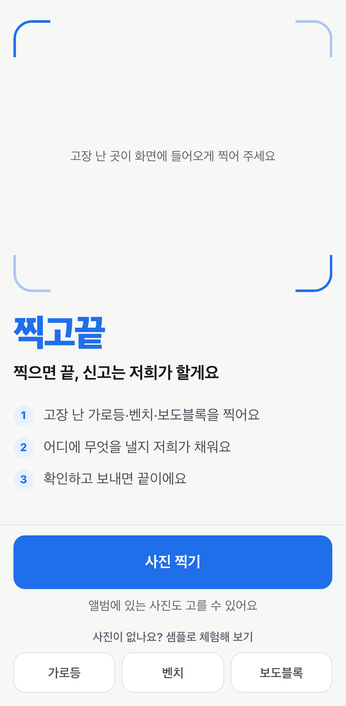 |
| 자동으로 채운 확인 화면 | 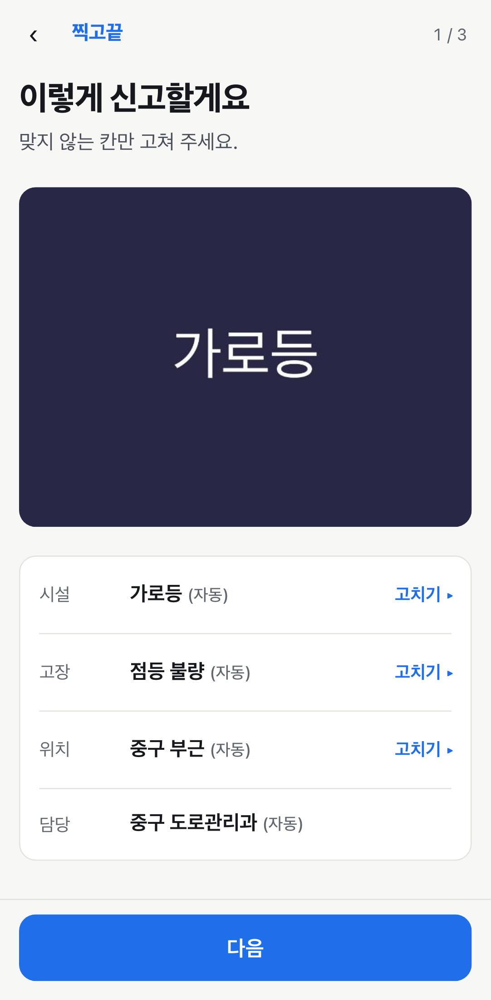 |
| 신고글 미리보기 | 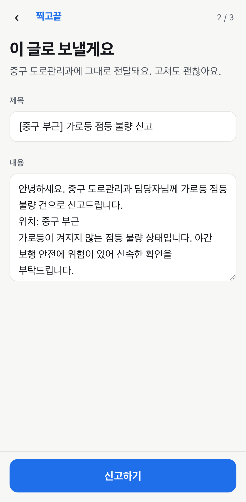 |
| 접수증과 QR | 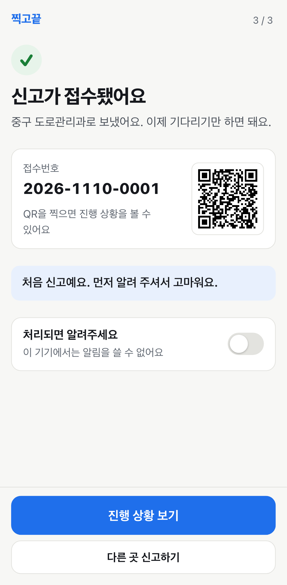 |
| 진행 상황 - 배정 | 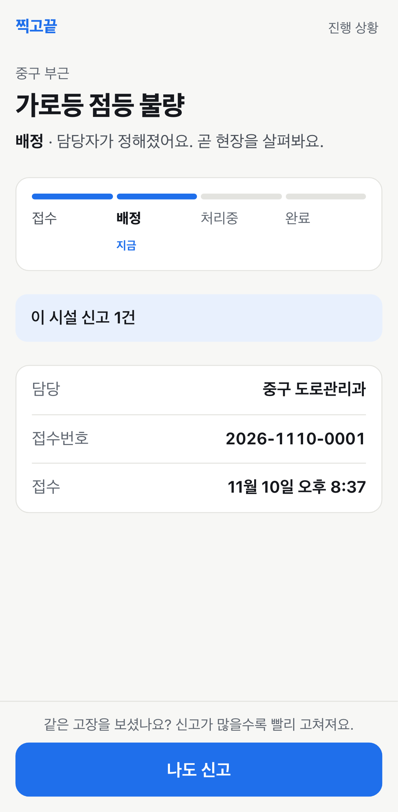 |
| 진행 상황 - 완료 | 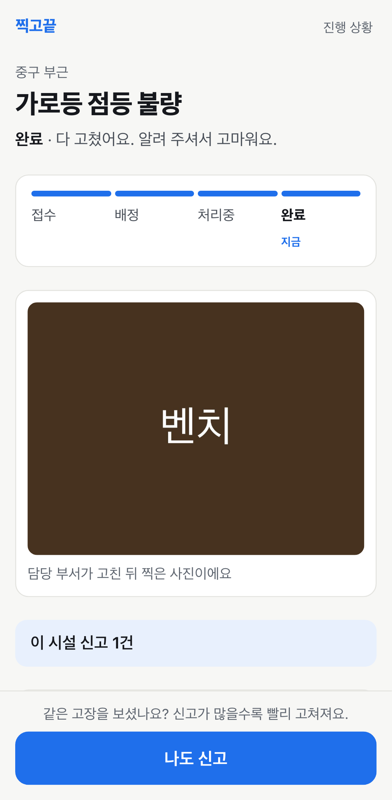 |
| 같은 곳 신고 묶음 안내 | 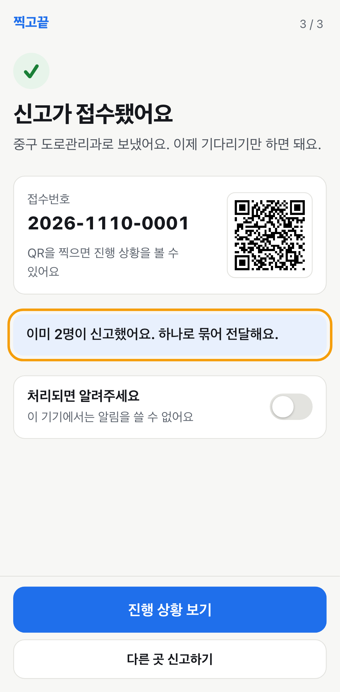 |
| 인터넷이 끊겼을 때 | 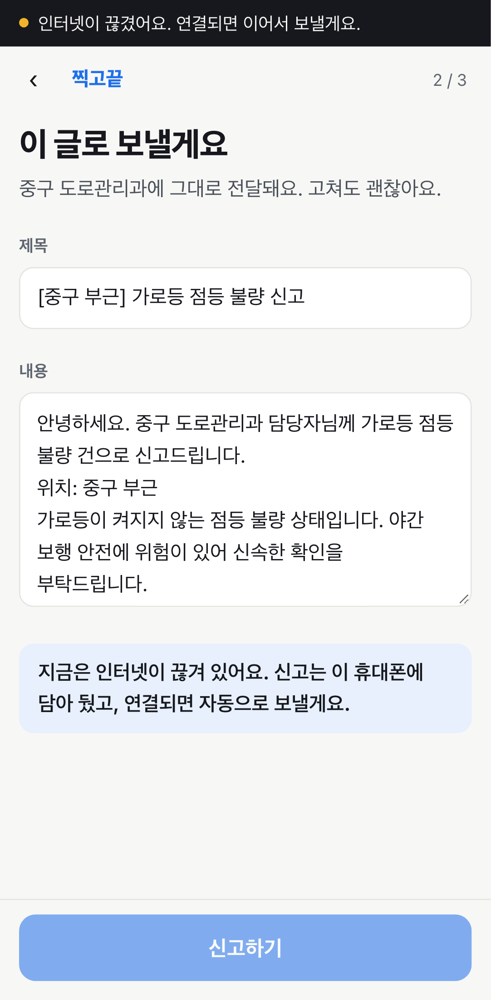 |
| 지도로 위치 맞추기 | 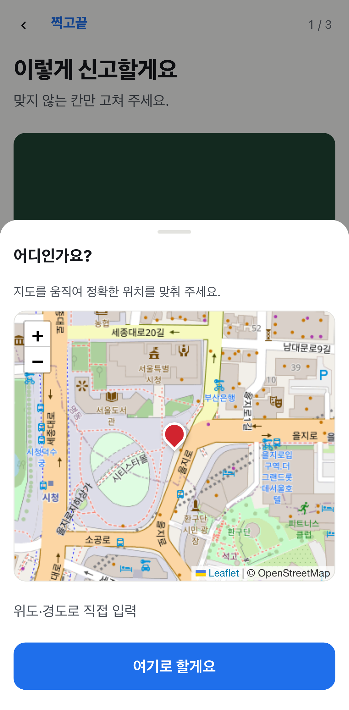 |
| 응급 안내 (112·119) | 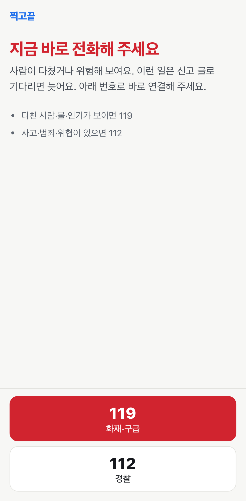 |
| 사진 확인 실패 안내 | 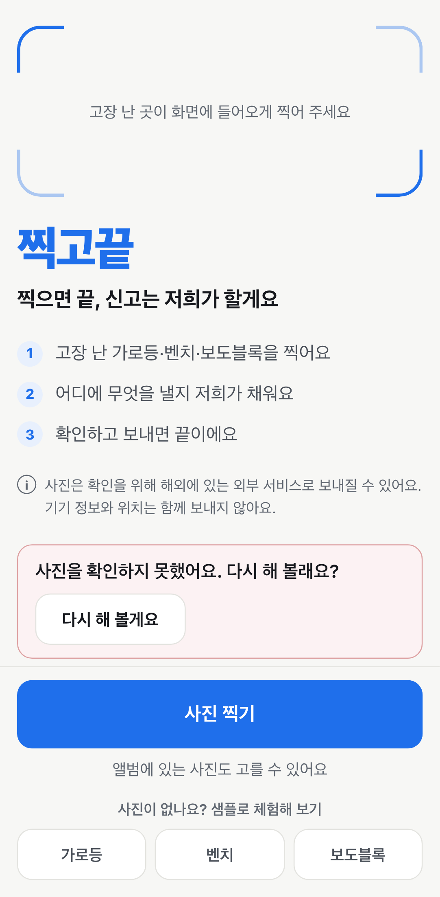 |
| 요청이 많을 때 안내 | 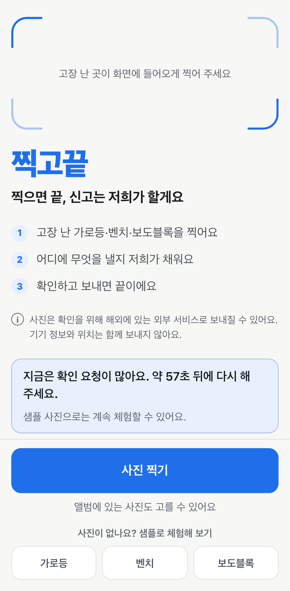 |
| 외부 전송 고지 | 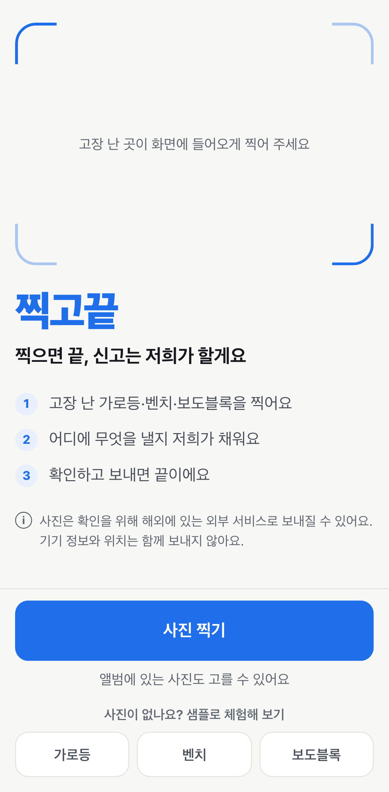 |
| 담당자 신고 현황판 (모의) | 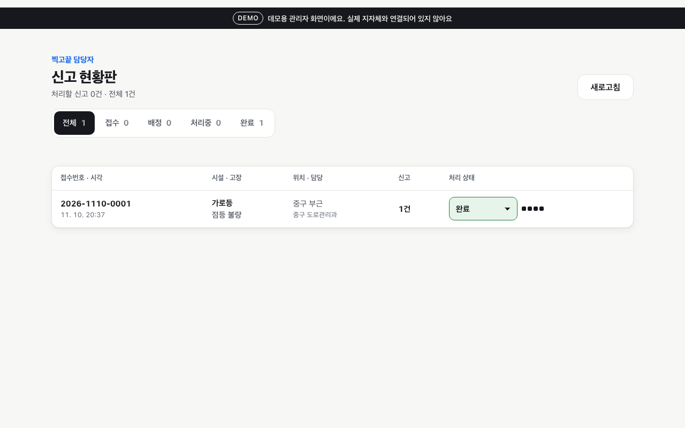 |
| 첫 화면 (기본) |  |
| 확인 화면 (기본) |  |
| 접수증 (기본) | 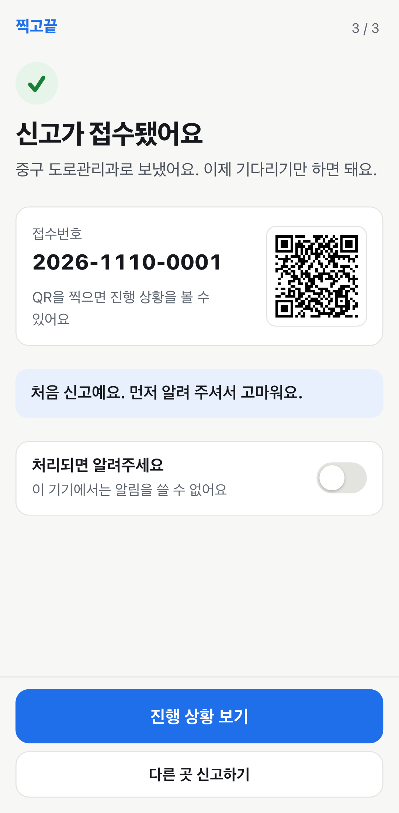 |
| 완료 확인 (기본) | 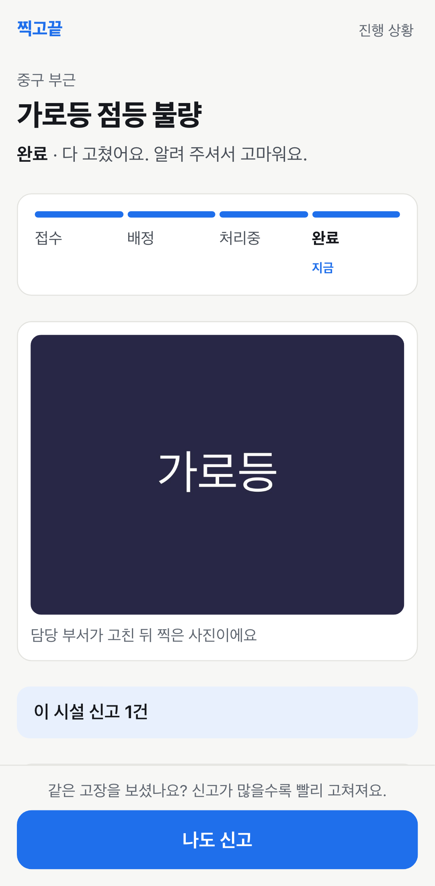 |
| 담당자 화면 (기본) | 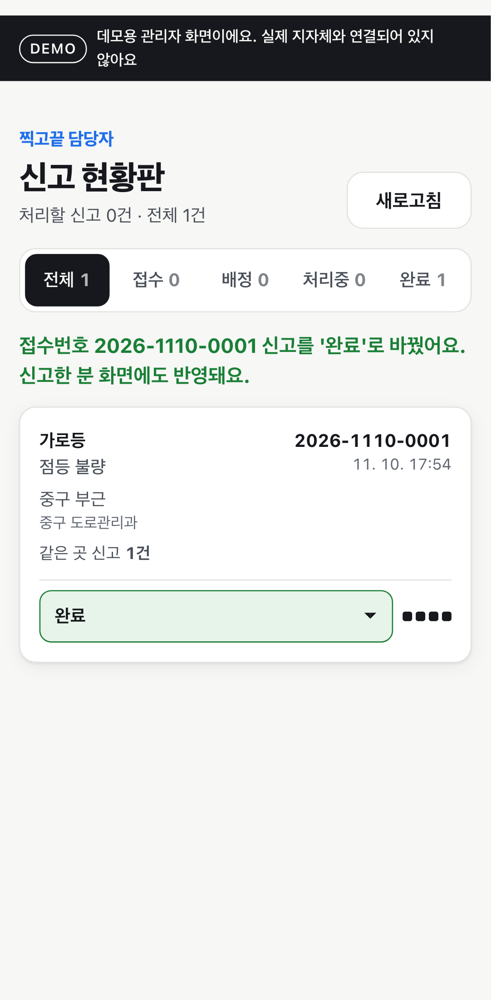 |
