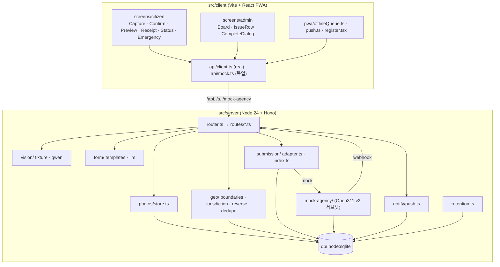
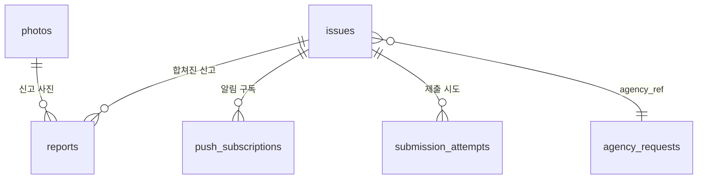
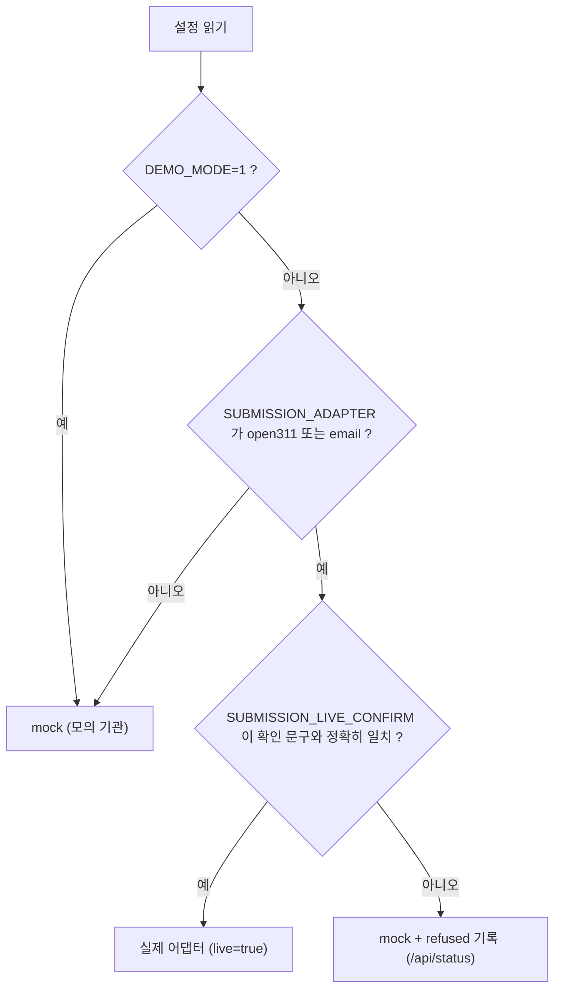
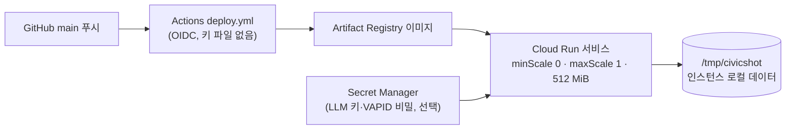

# 시스템 개요 (찍고끝)

README 의 아키텍처 절을 자세히 풀어 쓴 문서입니다. 계약(타입·API·스키마)은 `src/shared/types.ts`, `src/server/db/schema.sql` 이 기준입니다.

## 전체 구성

## 모듈 지도

| 경로 | 책임 |
|---|---|
| `src/shared/types.ts` | 분류 체계(시설·고장·상태), 도메인 타입, `Api` 인터페이스 — 화면과 서버가 같이 쓰는 계약 |
| `src/server/main.ts` | 설정 읽기, 어댑터 선택, 서버 기동 |
| `src/server/config.ts` | 환경변수 → `Config` (기본값 포함) |
| `src/server/router.ts`, `routes/` | 라우트 등록: photos, classify, locate, form, reports, issues, status, push, admin, webhooks, health, test |
| `src/server/static.ts` | 빌드된 화면(`CLIENT_DIST_DIR`) 서빙, `/s/:token` 상태 페이지 |
| `src/server/photos/` | 업로드 사진 저장(크기 제한 5 MB), 조회, 보존 만료 처리 |
| `src/server/vision/` | 사진 분류. `fixture`(결정적, 키 불필요) / `qwen`(OpenAI 호환 비전 모델, 실패 시 fixture 로 강등). 흐름: 샘플 우선 → 요청 한도 소비 → 외부 호출 |
| `src/server/geo/` | 시군구 경계 point-in-polygon(turf), 주소 문구(오프라인 라벨 / Nominatim), 담당 부서(`data/departments.json`), H3 + haversine 중복 병합 |
| `src/server/form/` | 민원 양식: 서식 템플릿(기본) / LLM(선택, 실패 시 템플릿) |
| `src/server/submission/` | `SubmissionAdapter` 인터페이스, Open311·이메일 어댑터, 선택 가드, 재시도 기록 |
| `src/server/mock-agency/` | 모의 기관: Open311 GeoReport v2 서브셋 + 관리자 API, 상태 변경 시 웹훅 |
| `src/server/notify/` | Web Push 전송 (완료 때) |
| `src/server/retention.ts` | 보존 기간이 지난 사진·신고 정리 (`SWEEP_MINUTES` 주기) |
| `src/server/db/` | `node:sqlite` 연결·마이그레이션, 테이블별 저장소 |
| `src/client/screens/citizen` | 시민 흐름 화면 |
| `src/client/screens/admin` | 담당자 모의 현황판 |
| `src/client/components` | 공용 컴포넌트(버튼·필드·상태 단계·사진·지도 위치 보정 등) |
| `src/client/pwa` | 서비스 워커 등록, 오프라인 신고 큐(IndexedDB), 푸시 구독 |
| `src/client/lib/photo.ts` | EXIF 읽기(exifr) + 재인코딩 압축(compressorjs) |
| `data/` | `boundaries/sig-seoul.geojson`(서울 25구), `departments.json` |
| `tests/unit`, `tests/e2e`, `tests/pwa` | Vitest 단위, Playwright E2E, PWA 빌드본 검사 |
| `deploy/gcp`, `Dockerfile`, `.github/workflows` | 컨테이너·Cloud Run 배포 키트·CI |

## 데이터 모델

| 테이블 | 주요 컬럼 | 설명 |
|---|---|---|
| `photos` | id, path, lat, lng, taken_at, width, height, bytes, sha256, purged | 업로드 사진. 만료 후 `purged=1`, 조회 시 410 |
| `issues` | id, receipt_no, status_token, facility, fault, lat, lng, h3, sig_code, sig_name, department, address_label, status, report_count, agency_ref, completion_photo_id | 시설 하나의 고장 한 건. 근처 같은 시설 신고는 여기로 합쳐짐 |
| `reports` | id, issue_id, photo_id, reporter_token, form_title, form_body, form_source, merged | 개별 신고 |
| `push_subscriptions` | id, issue_id, subscription_json | Web Push 구독 |
| `submission_attempts` | id, issue_id, adapter, ok, error | 제출 시도 기록(재시도 최대 3회) |
| `agency_requests` | id, service_code, description, lat, lng, media_url, status, completion_photo_id | 모의 기관 쪽 접수 건 |

## API

| 메서드·경로 | 응답 | 설명 |
|---|---|---|
| `GET /health` | `{ok, adapter}` | 상태 확인 |
| `GET /api/status` | `{adapter, live, refused?, backends}` | 어떤 어댑터·백엔드가 켜졌는지 |
| `POST /api/photos` (multipart) | 201 Photo / 400 | 사진 업로드 |
| `GET /api/photos/:id` | jpeg / 404 / 410 | 사진 조회 |
| `POST /api/classify` | Classification | 시설·고장 유형 |
| `POST /api/locate` | Location / 422 `out_of_coverage` | 관할·주소·담당 부서 |
| `POST /api/form` | ComplaintForm / 422 `emergency`·`unsupported` | 양식 생성 |
| `POST /api/reports` | 201 접수 결과(병합 여부 포함) | 신고 접수·제출 |
| `GET /api/issues/:id` | Issue | 이슈 조회 |
| `GET /api/issues/by-token/:token` | Issue + 완료 사진 주소 | 신고자 상태 화면 |
| `GET /api/issues/by-token/:token/qr.svg` | SVG | 상태 페이지 QR |
| `GET /api/issues?status=&limit=` | Issue[] | 관리자 목록(인증 없음, 데모 전용) |
| `POST /api/push/subscribe` | 201 | 푸시 구독 |
| `POST /api/webhooks/agency` | 204 | 기관 상태 변경 수신 |
| `GET /s/:token` | HTML / 404 | QR 이 가리키는 상태 페이지 |
| `GET /mock-agency/v2/services.json` 외 | Open311 | 모의 기관 (services, requests 생성·조회) |
| `GET·PATCH /mock-agency/admin/requests` | AgencyRequest | 모의 기관 관리자 (완료는 완료 사진 필수) |
| `POST /api/_test/sweep·reset` | — | `ALLOW_TEST_ROUTES=1` 일 때만 |

오류 본문은 `{error, message?}`, `/api/*` 는 `Cache-Control: no-store`.

## 제출 어댑터 가드

- 모의 기관도 `Open311Adapter` 로 부릅니다(엔드포인트만 `SELF_BASE_URL/mock-agency/v2`). 실제 Open311 서버와 같은 코드 경로를 탑니다.
- 거부된 설정은 기동 로그 한 줄과 `/api/status` 의 `refused` 로 드러납니다.

## 보존·삭제

- 사진: `PHOTO_TTL_DAYS`(기본 7일) 뒤 파일을 지우고 `purged` 표시.
- 신고: `REPORT_TTL_DAYS`(기본 30일) 뒤 정리.
- 정리 주기: `SWEEP_MINUTES`(기본 10분), 서버 안 타이머(별도 큐 없음).
- EXIF 는 브라우저 재인코딩으로 제거되어 서버에 오지 않습니다. 계정·연락처는 저장하지 않습니다.

## 배포 구성

- 이미지 한 개: 서버 + 빌드된 화면. `node` 사용자, 쓰기는 `DATA_DIR` 에만.
- 기본값 `DEMO_MODE=1`, `SUBMISSION_ADAPTER=mock`, `GEOCODER=offline`, `VISION_BACKEND=fixture`, `LLM_BACKEND=template`. 키 비밀이 있으면 `apply-env.sh` 가 qwen 백엔드를 켭니다.
- 인스턴스가 내려가면 데이터가 사라집니다(데모용).

## 확장점

| 확장 | 위치 | 방법 |
|---|---|---|
| 지오코더 | `src/server/geo/reverse.ts`, `GEOCODER` | 키가 필요한 국내 지오코더를 새 백엔드로 추가 |
| 경계 데이터 | `scripts/fetch-boundaries.sh`, `data/boundaries` | 전국 시군구를 내려받아 단순화(mapshaper) 후 교체, `departments.json` 확장 |
| 분류기 | `src/server/vision/`, `VISION_BACKEND` | 같은 `Classification` 을 돌려주는 백엔드 추가 |
| 양식 | `src/server/form/` | 지자체별 서식 템플릿 추가, LLM 프롬프트 조정 |
| 제출 경로 | `src/server/submission/adapter.ts` | `SubmissionAdapter` 구현 추가. 가드(`DEMO_MODE`·확인 문구)는 공통 적용 |
